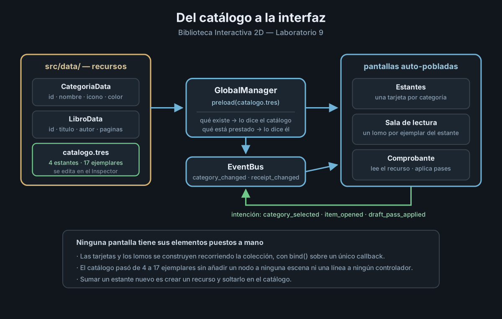

# ADR-006 — Catálogo en recursos e interfaz generada a partir de los datos

| Campo | Valor |
| --- | --- |
| **Estado** | Aceptada |
| **Fecha** | 2026-10-23 |
| **Autor** | Jolman Harley Gamboa Salamanca |
| **Contexto** | Producción de Videojuegos 2026-2 — Laboratorio 9 (Sprint 3) |
| **Relacionada con** | ADR-001 (Event Bus), ADR-003 (GlobalManager), ADR-005 (Persistencia) |

## Contexto

El catálogo de la biblioteca vivía como una constante dentro de
`GlobalManager`:

```gdscript
const CATALOGO: Dictionary = {
    "dune": {"titulo": "Dune", "autor": "Frank Herbert"},
    ...
}
```

Y la sala de lectura tenía cuatro botones puestos a mano en la escena, uno por
ejemplar, cada uno conectado por su nombre:

```gdscript
btn_dune.pressed.connect(_on_libro_pressed.bind("dune"))
btn_neuromante.pressed.connect(_on_libro_pressed.bind("neuromante"))
```

Con cuatro libros funcionaba. El problema aparece al intentar crecer, y son
tres problemas distintos:

1. **Sumar un ejemplar obligaba a tocar tres sitios**: la constante del gestor,
   un botón nuevo en la escena y una línea de conexión en el controlador. Tres
   oportunidades de olvidarse de una.
2. **Los datos no tenían forma**. Un diccionario anidado no declara qué campos
   existen ni de qué tipo son: `libro["titulo"]` compila aunque el campo se
   llame `nombre`, y el error aparece en ejecución.
3. **La interfaz no podía crecer sin rehacerse**. Con cuatro ejemplares caben
   cuatro botones; con diecisiete repartidos en cuatro estantes, la pantalla
   necesita saber cuántos dibujar, y eso solo puede decidirlo el dato.

## Decisión

Se separa el catálogo de la interfaz que lo representa, en tres piezas.

### 1. Los datos son recursos, no literales

Tres clases que heredan de `Resource`, en `src/data/`:

| Clase | Qué modela |
| --- | --- |
| `LibroData` | Un ejemplar: `id`, `titulo`, `autor`, `anio`, `categoria`, `paginas`, `sinopsis`, `portada` |
| `CategoriaData` | Un estante: `id`, `nombre`, `descripcion`, `icono`, `color` |
| `CatalogoBiblioteca` | La colección: `Array[CategoriaData]`, `Array[LibroData]` y sus consultas |

Las propiedades van con `@export`, de modo que el catálogo se edita en el
Inspector como cualquier otro recurso, sin abrir un editor de texto.

Las consultas —`libros_de()`, `buscar_libro()`, `buscar_categoria()`,
`contar_libros()`— viven en `CatalogoBiblioteca` y no en `GlobalManager`,
porque son preguntas **sobre los datos**, no sobre el estado de la sesión. El
gestor sigue siendo el dueño de qué está prestado; el catálogo es el dueño de
qué existe.

### 2. El catálogo es un recurso único, cargado con `preload`

```gdscript
const CATALOGO: CatalogoBiblioteca = preload("res://src/data/catalogo.tres")
```

`src/data/catalogo.tres` contiene cuatro estantes y diecisiete ejemplares. Al
ser `preload`, el catálogo está disponible desde el primer fotograma, incluido
el `_ready()` del Autoload, que es donde se carga el guardado y hay que validar
contra él los ejemplares leídos del disco.

### 3. La interfaz se genera recorriendo la colección

Ni la pantalla de estantes ni el estante de la sala tienen sus elementos
puestos en la escena: ambos los construyen en tiempo de ejecución dentro de un
`ScrollContainer`, conectando cada botón con `bind()` sobre un único callback.

La consecuencia práctica es la que buscaba el laboratorio: **el catálogo pasó
de cuatro ejemplares a diecisiete sin añadir un solo nodo a ninguna escena ni
una sola línea a ningún controlador.**

### 4. El comprobante, entre la elección y el registro

La máquina de estados del ADR-004 gana un estado, `EN_COMPROBANTE`, entre
`EN_CONSULTA` y `REGISTRANDO`. Elegir un plazo ya no registra el préstamo: arma
un borrador que el lector revisa en una pantalla que lee los datos del recurso,
y que permite aplicar los pases persistidos del ADR-005 antes de confirmar.

Hasta la confirmación no se escribe nada en el registro, de modo que cancelar
no deja rastro. Esa es la ventaja de separar la intención del efecto.

## Alternativas consideradas

| Alternativa | Motivo del rechazo |
| --- | --- |
| Mantener el diccionario constante y solo ampliarlo | Resuelve el tamaño pero ninguno de los tres problemas: los datos siguen sin forma y la interfaz sin poder crecer sola. |
| Cargar el catálogo desde un `.json` en `res://` | Es editable fuera de Godot, pero vuelve a dejar los datos sin tipo y sin validación del editor, y obliga a escribir el parseo a mano. Lo que aquí se gana al usar `Resource` es precisamente lo que el ADR-005 tuvo que programar a mano para el guardado. |
| Un `.tres` por ejemplar, referenciados desde el catálogo | Más granular y cómodo para un equipo grande, porque cada archivo se versiona aparte. Con diecisiete ejemplares añade diecisiete archivos sin aportar nada: se descarta por ahora y se deja anotado en el backlog. |
| Dejar los botones del estante en la escena y solo ocultarlos | Obliga a tener de antemano tantos nodos como el ejemplar más numeroso, y a mantenerlos sincronizados a mano. Es exactamente lo que el auto-poblado elimina. |
| Que las pantallas consulten `CATALOGO` directamente para todo | Para leer el catálogo es aceptable —es un dato inmutable—, pero no para el estado. Por eso la sala lee títulos del catálogo y recibe por el bus qué está prestado y en qué estado va el ciclo. |

## Consecuencias

**Ventajas**

- Añadir un ejemplar es editar un recurso. Ninguna escena, ningún controlador y
  ninguna constante cambian.
- Los campos tienen tipo declarado: equivocarse de nombre es ahora un error del
  editor y no una sorpresa en ejecución.
- El catálogo es inspeccionable durante la sustentación: se abre el `.tres` y
  se ve la colección.
- La pantalla de estantes y el estante de la sala comparten el mismo principio,
  así que la próxima pantalla que liste algo ya tiene el patrón resuelto.
- Los identificadores que ya existían se conservaron, de modo que los guardados
  anteriores siguen siendo válidos.

**Costos**

- Hay más archivos y más indirección: para saber qué libros existen ya no basta
  con leer el gestor, hay que abrir el recurso.
- Un catálogo mal formado deja de ser un error de sintaxis y pasa a ser un
  recurso que carga vacío. Se mitiga con el saneamiento que el ADR-005 ya hacía
  al leer el guardado, que ahora valida también contra el catálogo.
- Cargar diecisiete ejemplares a mano en el Inspector es lento, así que el
  catálogo se generó con una herramienta de autor (`tools/build_catalogo.gd`)
  que lo reescribe entero. A partir de ahí se edita en el editor, y conviene no
  volver a ejecutarla si el recurso ya divergió.

## Justificación

El laboratorio pide separar los datos de su representación, y el proyecto tenía
el caso perfecto para demostrarlo: una pantalla con cuatro botones escritos a
mano que no podía crecer. La prueba de que la separación funciona no es que el
código quede más limpio, sino que **cuadruplicar el catálogo no obligó a tocar
la interfaz**: el estante nuevo de clásicos universales se dibuja solo, con sus
cuatro ejemplares, porque la pantalla pregunta en vez de saber.


